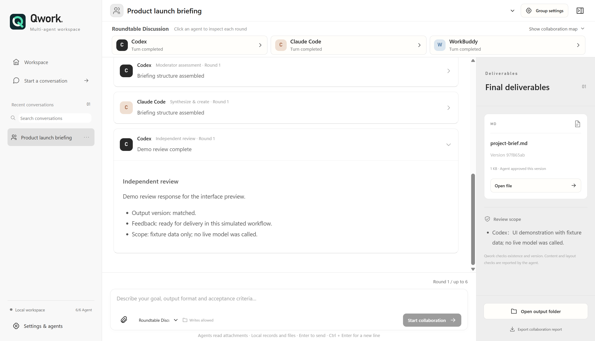
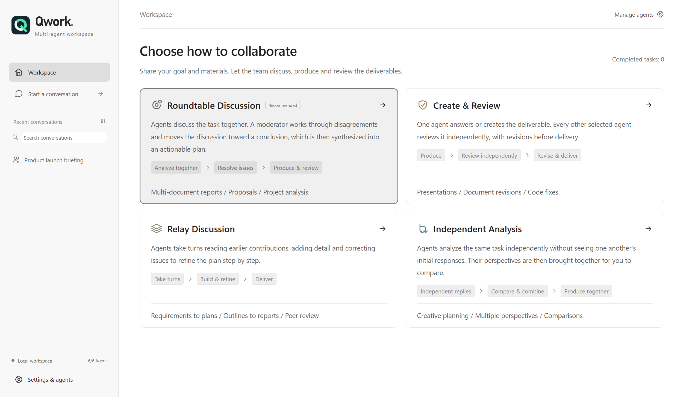
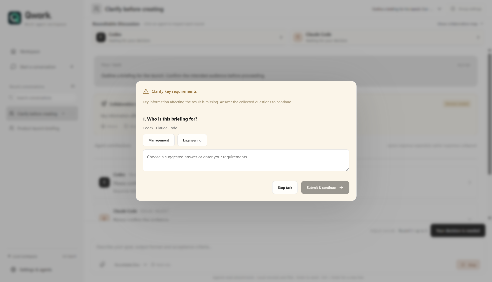
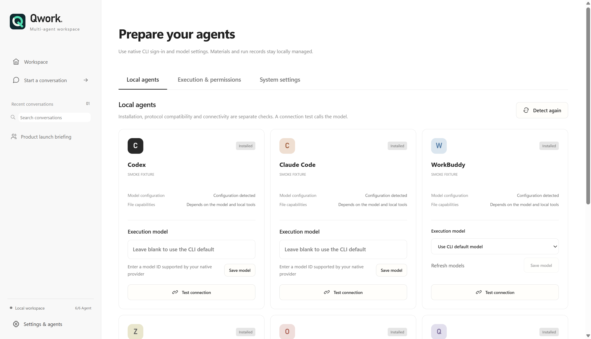

<div align="center">


# Qwork

### Your agents. One brief. A deliverable.

Turn project materials into a proposal, report or presentation—with your local agents working together and reviewing the result.

**Codex · Claude Code · WorkBuddy · Zcode · OpenClaw · Qwen Code**

**English** · [简体中文](README.zh-CN.md)


[Get started](#get-started) · [Choose a workflow](#choose-a-workflow) · [See the experience](#see-the-experience)

</div>



<sub>Actual Electron UI, switched to English before capture. Screenshots use isolated demonstration data and simulated agents.</sub>

## Spend less time relaying answers

You have project notes, research material and a result to deliver. Working across several agents often means copying context between terminals, reconciling their answers and asking someone to check the final file.

Qwork puts that work in one place: **give the team a brief, choose how it collaborates, and keep the final answer or files alongside the review.** Your existing CLIs provide the models and tools; Qwork coordinates the work.

- **Choose how the team works.** Discuss together, build on earlier answers, compare independent perspectives, or start with a draft and review it.
- **Stay in control.** See who is discussing, moderating, creating or reviewing. Answer critical questions when the team needs your decision.
- **Keep the result close.** Open the delivered file from the conversation or the files panel, with the review alongside it.

Try a brief like this:

> Use the attached project materials to create a management presentation. Cover progress, key metrics, risks and next steps. Ask about critical gaps, preserve the sources and have another agent review the actual deliverable.

Presentation creation and rendering require suitable tools in the chosen agent environment. [More briefs to try →](examples/README.md)

## What would you like to finish?

| Start with | Ask the team for | Try |
| --- | --- | --- |
| Project notes and source documents | A management briefing with sources and open questions | Roundtable Discussion |
| A report or presentation draft | A revised file with independent checks | Create & Review |
| A rough product idea | Requirements, implementation steps and acceptance criteria | Relay Discussion |
| Several possible approaches | A comparison of trade-offs and a decision memo | Independent Analysis |

These are starting briefs, not guaranteed output formats. File creation and rendering use the tools available to your agents.

## Choose a workflow

| Mode | What happens | Good starting points |
| --- | --- | --- |
| **Roundtable Discussion** | Agents discuss a shared task. A moderator resolves critical blockers and decides when the deliverable owner can synthesize the result and optionally create files. | Multi-document briefings, project analysis, comprehensive proposals |
| **Create & Review** | One creator answers or produces the deliverable. **Every other selected agent** independently reviews the same version; feedback goes back to the creator. | Revising reports, improving presentations, fixing code |
| **Relay Discussion** | Agents read earlier contributions in sequence, add detail and correct issues. A moderator guides further discussion until the plan is ready. | Requirements, implementation plans, report outlines |
| **Independent Analysis** | Agents receive the same frozen input and answer independently. The owner compares and synthesizes their perspectives in **one analysis pass**, with optional file creation. | Comparing approaches, exploring alternatives, getting different perspectives |

**Clear responsibilities, fewer handoffs.** In Roundtable Discussion, Relay Discussion and Independent Analysis, one deliverable owner handles synthesis and, when requested, file creation in the same call. Discussion stays read-only; a different agent checks the files. Create & Review skips team discussion entirely.

Roundtable and Relay discussions can end early when the moderator clears the plan to proceed; they do not require unanimous votes. Their round limit can be adjusted during execution, up to 8 and above the current round. Independent Analysis has no multi-round discussion setting. Create & Review has its own review limit.

## See the experience

### Start with the workflow that fits

Choose a mode on the home screen, then set the goal, participants and working directory. Keep simple questions in single-agent chat; bring in a team when different perspectives or independent review help.



Replies stream as Markdown. The latest answer opens automatically; opening an earlier answer takes you to its beginning. Files and review notes stay in the delivery panel, which opens when a task finishes with files.

### Let the team ask when it matters

Critical missing requirements pause the task. Questions from the same batch are collected, duplicate wording is merged, and you can choose an answer or write your own. Local answers rerun the relevant member; changes to shared requirements refresh affected analysis and reviews.

A desktop notification takes you back to the right task. Writing resumes only after your explicit submission, with existing drafts retained. Ordinary preferences use stated defaults rather than interrupting every task.



### Bring the agents you already use

**Codex · Claude Code · WorkBuddy · Zcode · OpenClaw · Qwen Code**

Use native sign-in and provider configuration. Set model IDs for Codex, Claude Code and Qwen Code, or choose a configured WorkBuddy model. Zcode and OpenClaw currently follow native model configuration. WorkBuddy uses the `codebuddy` command.

The app supports Chinese and English, light/dark/system appearance, single-agent chat, group history, attachments, and settings organized into **Local agents · Execution & permissions · System settings**.

<details>
<summary>View the English agent settings</summary>



</details>

## Get started

**Supports Windows 10/11 x64. Qwork itself does not require a separate Node.js installation; configure at least one supported Agent CLI before use.** Group collaboration requires at least two available agents.

| Launch method | Requirements |
| --- | --- |
| Windows installer / packaged portable directory | Includes Electron and Node.js. No separate Node.js, npm or Python installation is needed for Qwork itself. |
| Source / default BAT launcher | Requires Node.js 22.12+ and npm; first-time dependency installation needs internet access. |
| Agent task execution | Install each CLI, sign in and configure its model separately. Install any system runtime that CLI requires; Qwork's bundled runtime does not replace external CLI prerequisites. |

The current release target is x64, not 32-bit Windows; ARM devices have not been verified. Not every Windows 10/11 version has been compatibility-tested. The unsigned installer may trigger Windows security prompts or be restricted by enterprise policy.

You need **Windows x64**, **Node.js 22.12+**, npm, and the agent CLIs you want to use. Install and configure the CLIs separately; a group requires at least two available agents. No Qwork account or required application server.

### Double-click from source

Download the repository with **Code → Download ZIP**, extract it, then open **[Start-Qwork.bat](Start-Qwork.bat)** in the repository root. The launcher checks prerequisites, installs locked dependencies if missing, builds the current source and starts Qwork. The first dependency installation needs internet access.

```bat
Start-Qwork.bat --check
Start-Qwork.bat --portable
```

`--check` only checks prerequisites. `--portable` runs an existing `release/win-unpacked/Qwork.exe`; keep its entire directory together. Portable mode does not rebuild the current source.

### Start from a terminal

```powershell
npm ci
npm run dev
```

Then: **Settings & agents → detect agents → test a connection → choose a mode → add materials → start collaborating.** Connection tests call the configured model and may incur provider charges.

### Build a Windows installer

```powershell
npm run dist:win
```

The installer is generated under `release/`. It bundles the application runtime; agent CLIs remain separate. Build from the source revision you intend to distribute; older preview binaries may predate this README. Signing is not configured.

## How Qwork keeps work reviewable

- **One writer, independent reviewers.** Writing is limited to the production role; discussion and review use read-only CLI modes. New groups visibly enable workspace-write authorization by default; review it before creation.
- **Version-bound file checks.** Qwork fingerprints output files and rejects approvals for a different version or files changed during review.
- **Visible failure handling.** Startup, inactivity, no-progress and total-call limits bound waiting. Abnormal members are removed with an explanation; a reduced team is visibly labeled.
- **Preserved work.** Partial files and discussion remain available. Cancelled or interrupted writes are not automatically replayed. Removing a conversation retains its files.
- **Local records.** Conversations, inputs and outputs stay on disk. Native CLIs may send task data to their configured providers.

<details>
<summary>File capabilities, privacy and web access</summary>

Qwork manages attachment copies, paths, metadata and fingerprints. Agents read the contents using their own tools. Office/PDF reading, OCR, file generation and page rendering depend on the chosen CLI, model and installed tools. Review notes distinguish checked content from unverified visual layout.

The web setting maps to the six native adapters. Provider support, credentials, network access and native policy still determine whether search works. CLI permissions are not an OS-level firewall or sandbox.

</details>

## Explore the repository

```text
src/renderer/   Vue interface, conversations, settings and deliverables
src/main/       Workflow, validated IPC, CLI service and local storage
src/shared/     Typed contracts and language resources
legacy/         Attributed Meldwork CLI compatibility modules
test/           Workflow, process, permission and notification tests
examples/       Briefs for the four modes
docs/screenshots/  Images used by the English and Chinese READMEs
scripts/        Build, test and screenshot tooling
.github/        Windows CI, issue form and PR template
```

[Contributing](CONTRIBUTING.md)

**Validation:** 101 Qwork tests, type checks, production builds and Electron fixture acceptance passed locally. These checks use fixture agents; live provider and file-format coverage remains incomplete.

<details>
<summary>Developer checks and screenshot generation</summary>

```powershell
npm run typecheck
npm test
npm run test:legacy
npm run build
npm run smoke
npm run screenshots
```

Screenshot generation uses isolated fixture data and no live model calls. English screenshots are captured after switching both the interface and demo task to English. Migrated credential/permission checks: 34 passed, 10 platform skips.

</details>

## Help shape Qwork

Try a task with your own agents and tell us where the collaboration helped—or got stuck. Particularly useful contributions are reproducible CLI compatibility reports, clearer review and recovery flows, and real task examples with private data removed. See [Contributing](CONTRIBUTING.md).

If Qwork fits your workflow, a star helps others discover it.

## Origin and license

Qwork is an independent derivative of the [Meldwork](https://github.com/Ryder-Sun/Meldwork) CLI compatibility layer, with a redesigned Vue/TypeScript interface and orchestration workflow. Original copyright belongs to Ryder-MHumble and Meldwork contributors. Agent names do not imply endorsement.

Apache-2.0 notices are preserved in [LICENSE](LICENSE) and [NOTICE](NOTICE). Generated dependencies, user data and release binaries are excluded from Git.
