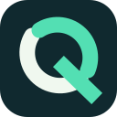
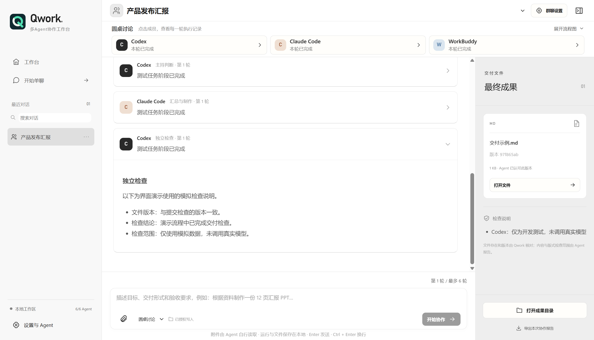
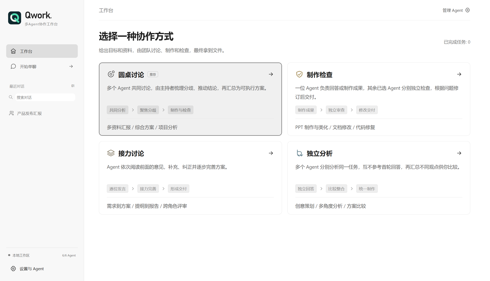
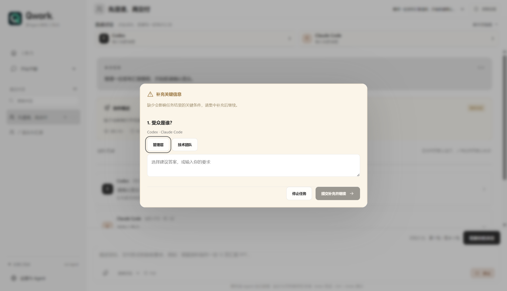
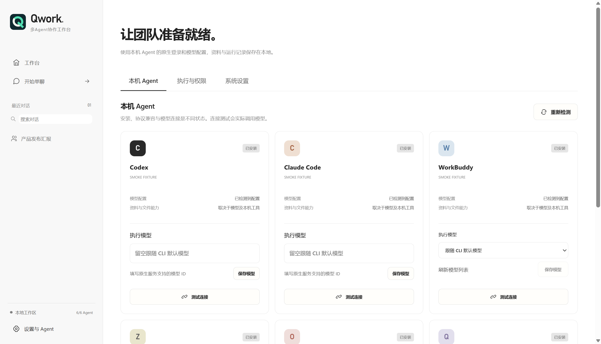

<div align="center">



# Qwork · 多 Agent 协作工作台

### 给团队一个目标，把最终成果带回来。

把项目资料变成方案、报告或演示文稿。让你已经在用的 Agent 分工协作，并由其他成员检查成果。

**Codex · Claude Code · WorkBuddy · Zcode · OpenClaw · Qwen Code**

[English](README.md) · **简体中文**


[开始使用](#开始使用) · [选择协作方式](#选择协作方式) · [看看实际体验](#看看实际体验)

</div>



<sub>截图来自实际 Electron 界面，使用独立演示数据与模拟 Agent；不是实际模型任务的交付案例。</sub>

## 少一点转发回答，多一点验收成果

一批项目资料、一份待完善的报告、几个需要比较的方案。你知道最终要什么，却要在多个终端间复制上下文、整合意见、安排修改，再找人检查文件。

Qwork 把这些事情放进一个工作台：**提交任务和资料，选择协作方式，把最终回答、成果文件和检查说明放在一起。** 模型与工具由本机 CLI 提供，Qwork 负责组织协作。

- **协作方式由任务决定。** 一起讨论、接力完善、独立分析，或直接制作再检查。
- **关键决定交给你。** 看清谁在讨论、主持、制作、检查；遇到关键缺失时集中提问。
- **交付文件就在手边。** 从对话链接或成果面板打开文件，同时查看检查说明。

你可以从这样的任务开始：

> 根据附件项目资料制作管理层汇报，包含进展、关键指标、风险和下一步计划。遇到关键缺失先提问，保留来源，生成实际文件后交给另一位 Agent 独立检查。

PPT 制作与渲染需要所选 Agent 环境具备相应工具。[查看更多示例任务 →](examples/README.md)

## 你想完成什么？

| 手头有什么 | 希望交付什么 | 可以选择 |
| --- | --- | --- |
| 项目记录与参考资料 | 带来源和待确认事项的管理层汇报 | 圆桌讨论 |
| 报告或 PPT 初稿 | 经独立检查的修订文件 | 制作检查 |
| 一个待落地的产品想法 | 需求、实施步骤与验收标准 | 接力讨论 |
| 几种候选方案 | 说明取舍的对比分析与决策备忘录 | 独立分析 |

以上是可尝试的任务方向。具体文件的制作与渲染，需要 Agent 环境具备相应工具。

## 选择协作方式

| 模式 | 怎么工作 | 适合做什么 |
| --- | --- | --- |
| **圆桌讨论** | 多个 Agent 共同讨论，由主持者梳理分歧、判断能否推进，再交给成果负责人汇总并按需制作文件。 | 多资料汇报、项目分析、综合方案 |
| **制作检查** | 一位制作者回答问题或制作成果，**其余所有已选 Agent** 独立检查同一版本，再根据问题修订。 | 报告修改、PPT 完善、代码修复 |
| **接力讨论** | Agent 依次阅读、补充和纠正前面的意见，由主持者推动后续讨论，逐步完善方案。 | 需求梳理、实施计划、报告提纲 |
| **独立分析** | 各成员接收相同的冻结输入，互不参考首轮回答；成果负责人在**单轮分析后**比较观点并汇总，按需制作文件。 | 方案比较、创意探索、多角度分析 |

**角色更清楚，交接更少。** 圆桌讨论、接力讨论、独立分析由同一位成果负责人完成汇总；需要文件时，在同一次调用中汇总并制作。讨论保持只读，文件由其他 Agent 独立检查。制作检查直接进入制作与检查，不增加团队讨论。

圆桌、接力讨论由主持者判断可推进，不要求全员投票一致；方案就绪即可提前结束。运行中可以调整后续轮数，上限 8 轮且须高于当前轮数。独立分析没有多轮讨论设置，制作检查则使用独立的检查次数上限。

## 看看实际体验

### 先选适合任务的协作方式

从首页选择模式，再填写目标、参与成员和工作目录。简单问题可以单聊，需要多角度分析或独立检查时再创建团队。



回复支持流式 Markdown，默认展开最新回答；展开历史回答时从开头阅读。文件与检查说明集中在右侧，任务结束且有文件时自动展开成果面板。

### 关键问题集中问，普通细节少打扰

缺少影响结果的关键信息时暂停任务，同批问题集中展示，合并重复表述。你可以点选建议答案或自行补充。局部问题只重做相关成员；全局要求变化则更新受影响的分析与检查。

桌面通知可带你回到对应任务。继续制作前需要明确提交，已有阶段文件会保留；普通偏好采用合理默认值并简短说明。



### 继续使用你熟悉的 Agent

**Codex · Claude Code · WorkBuddy · Zcode · OpenClaw · Qwen Code**

沿用原生登录与服务配置。Codex、Claude Code、Qwen Code 可指定模型 ID；WorkBuddy 可选择已配置模型；Zcode、OpenClaw 暂跟随原生模型配置。WorkBuddy 使用 `codebuddy` 命令。

支持中英文、浅色／深色／跟随系统、单聊、群聊历史与附件。设置按 **本机 Agent · 执行与权限 · 系统设置** 分组，减少在长页面里寻找选项。

<details>
<summary>查看中文 Agent 设置</summary>



</details>

## 开始使用

**支持 Windows 10/11 x64，应用无需额外安装 Node.js；使用前请配置至少一个受支持的 Agent CLI。** 群聊需要至少两个可用 Agent。

在「设置与 Agent → 本机 Agent」中，缺少 CLI 的项目提供快捷安装。Codex、Claude Code、WorkBuddy、OpenClaw 和 Qwen Code 沿用原项目的固定 npm 版本与校验配方；确认后才安装，支持取消和安装后检测。快捷安装需要系统 Node.js 与 npm，安装完成后仍需在原生 CLI 登录和配置模型。Zcode 提供官方配置入口。已安装桌面端不代表 CLI 可调用。

| 启动方式 | 环境要求 |
| --- | --- |
| Windows 安装包／打包后的免安装目录 | 自带 Electron 与 Node.js 运行时，无需为 Qwork 本身额外安装 Node.js、npm 或 Python。 |
| 源码／BAT 默认启动 | 需要 Node.js 22.12+ 和 npm，首次安装依赖需要联网。 |
| Agent 执行任务 | CLI 需单独安装、登录并配置模型；若该 CLI 依赖系统 Node.js 等环境，仍需按其要求安装。Qwork 内置运行时不替代外部 CLI 的环境。 |

当前发布目标为 x64，不覆盖 32 位 Windows；ARM 设备尚未验证。支持目标不代表已对所有 Windows 10/11 版本完成兼容性测试。未签名安装包可能受到 Windows 安全提示或企业策略限制。

准备 **Windows x64、Node.js 22.12+、npm**，以及你要使用的 Agent CLI。CLI 需要分别安装、登录并配置，群聊至少需要两位可用成员。Qwork 不要求单独注册账号，也不依赖必需的应用服务器。

### 双击，从源码启动

通过仓库的 **Code → Download ZIP** 下载并解压，然后双击根目录的 **[Start-Qwork.bat](Start-Qwork.bat)**。脚本检查环境，在缺少依赖时按锁文件安装，然后构建当前源码并启动。首次安装依赖需要联网。

```bat
Start-Qwork.bat --check
Start-Qwork.bat --portable
```

`--check` 仅检查环境。`--portable` 使用已有的 `release/win-unpacked/Qwork.exe`，需要保留整个目录，不会重新构建源码。

### 从终端启动

```powershell
npm ci
npm run dev
```

进入软件后：**设置与 Agent → 检测 Agent → 测试连接 → 选择模式 → 添加资料 → 开始协作。** 连接测试会实际调用所配置模型，可能产生提供者费用。

### 构建 Windows 安装包

```powershell
npm run dist:win
```

安装包生成于 `release/`，包含应用运行时；Agent CLI 仍需单独配置。发布时请使用准备交付的源码重新构建；旧预览安装包可能早于本文功能。当前未配置数字签名。

## 面向可以验收的工作

- **单一写入者，独立检查。** 讨论与检查使用只读 CLI 模式。新群聊会清楚展示默认勾选的工作目录写入授权，创建前可检查和调整。
- **检查绑定文件版本。** Qwork 对成果取指纹，拒绝错版认可；检查期间文件发生变化时，已有认可不能直接通过。
- **异常有交代。** 执行总时限与无实际执行反馈超时避免无限等待。异常成员移出时说明原因，团队缩减会明确展示。
- **阶段成果保留。** 取消或中断后不自动重放写入；删除对话也不会删除磁盘文件。
- **记录存放本机。** 对话、附件副本和成果保存在本地；原生 CLI 仍可能将任务数据发送到它所配置的模型服务。

<details>
<summary>文件能力、数据去向与联网说明</summary>

Qwork 管理附件副本、路径、元数据与哈希，由 Agent 使用自己的工具读取内容。Office／PDF 读取、OCR、文件制作和页面渲染取决于所选 CLI、模型与本机工具。检查说明会区分已核对的内容与尚未验证的视觉排版。

联网开关适配六种 CLI 的原生工具；搜索是否可用仍取决于服务商、凭据、网络和原生策略。CLI 权限模式不等于操作系统级防火墙或沙箱。

</details>

## 了解仓库

```text
src/renderer/   Vue 界面、对话、设置与成果面板
src/main/       任务编排、受验证 IPC、CLI 服务与本地存储
src/shared/     类型协议与语言资源
legacy/         保留来源声明的 Meldwork CLI 兼容模块
test/           工作流、进程、权限与通知测试
examples/       四种模式的任务示例
docs/screenshots/  中英文 README 使用的图片
scripts/        构建、测试与截图工具
.github/        Windows CI、Issue 表单与 PR 模板
```

[参与贡献](CONTRIBUTING.md)

**当前验证：** 105 项 Qwork 测试、类型检查、生产构建和模拟 Agent 的 Electron 验收通过。这些检查使用模拟 Agent；真实提供者和文件格式的验证覆盖仍不完整。

<details>
<summary>开发检查与截图生成</summary>

```powershell
npm run typecheck
npm test
npm run test:legacy
npm run build
npm run smoke
npm run screenshots
```

截图使用独立演示数据，不调用真实模型。英文截图在切换英文界面后生成，演示任务也使用英文。迁移凭据／权限回归 34 项通过，10 项按平台条件跳过。

</details>

## 一起完善 Qwork

欢迎用自己的 Agent 尝试一个真实任务，反馈哪些协作步骤有帮助、哪里仍会卡住。特别欢迎可复现的 CLI 兼容问题、检查与恢复体验改进，以及移除私人信息后的真实任务案例。参与方式见[贡献指南](CONTRIBUTING.md)。

如果 Qwork 适合你的工作方式，欢迎点一个 Star，让更多人发现它。

## 来源与许可

Qwork 基于 [Meldwork](https://github.com/Ryder-Sun/Meldwork) 的 CLI 兼容层二次开发，重新设计了 Vue／TypeScript 界面与协作编排。原版权归 Ryder-MHumble 和 Meldwork 贡献者所有。各 Agent 名称不代表官方合作或背书。

[LICENSE](LICENSE) 与 [NOTICE](NOTICE) 保留 Apache-2.0 许可及来源声明。依赖、用户数据与发布二进制不提交 Git。
