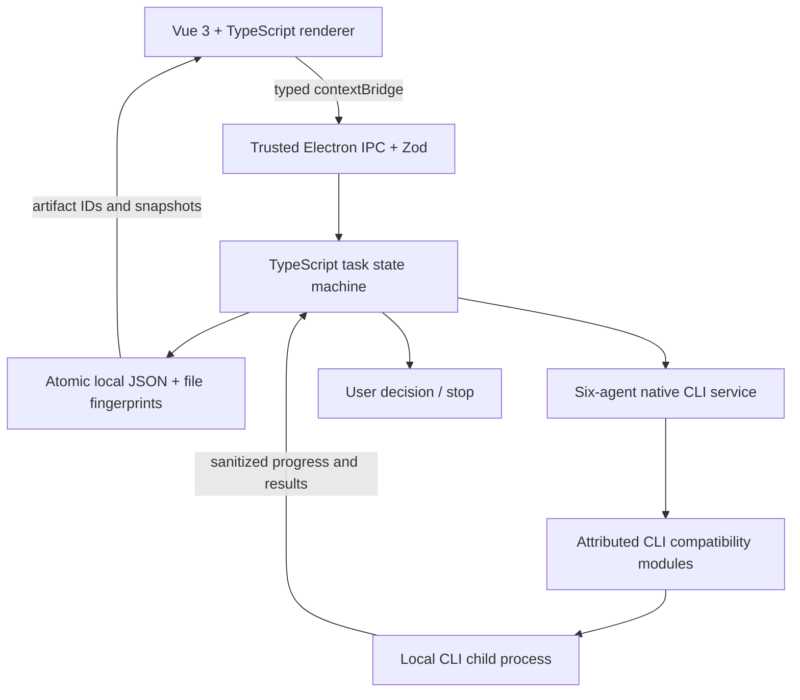

# Architecture

The renderer cannot choose an executable or arbitrary command. The main process uses an allowlist of six adapters, validates requests and verifies the sender's main frame and exact local renderer URL. File opening is by stored artifact ID, not arbitrary renderer paths. Executable/script artifacts are revealed in their folder rather than executed.

Each Run freezes a Group snapshot and attachment IDs. Attachment fingerprints are checked before every turn. Parallel batches freeze the prompt before starting any participant. Persistent state contains completed messages and public results; raw native credentials/session references are not exposed to the renderer. Model responses are sanitized at the native adapter boundary.

Production and read-only verification use separate CLI invocations. Plans and artifact manifests are content-hashed. Review acceptance requires the exact candidate version and a stated verification scope. Application-level checks establish file existence and version stability; they do not establish that a file is a valid PPT/Office document.

Every active run owns an AbortController. Stop propagates to the native adapter, including its existing Windows process-tree termination. Pending decision gates reject on cancellation. At startup, previously active states become interrupted and remain inspectable without automatically replaying side effects.

The deliverable owner now combines synthesis and production in one invocation when file output is enabled. Roundtable and Relay discussion still require the moderator to clear progression first. Independent Analysis is a single frozen batch followed by the owner. Text-only synthesis remains read-only. Critical production blockers stop with a partial result rather than automatically replaying writes.

Create & Review exposes only a creator role; every other selected agent reviews the same frozen answer/file version independently. Their checks must all have valid approvals, exact version receipts and stated verification scopes. A rejected or mismatched review cannot mark the files checked. Failed members are explicitly quarantined, with reduced-team provenance retained; fewer than two surviving members stop delivery. Other modes retain a separate read-only reviewer with bounded fallback. The legacy serialized summarizer field is retained for compatibility, but execution uses the selected owner (executor).
